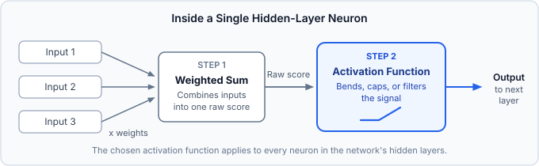
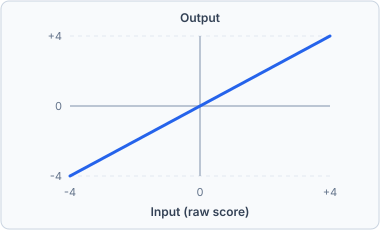
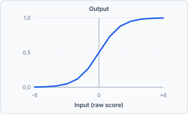
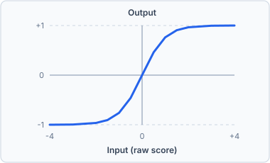
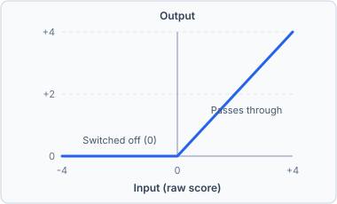

# Activation Function

Inside a [Multi-layer Perceptron (MLP)](TODO_LINK_TO_MLP_OVERVIEW_DOC), every neuron in a hidden layer processes information in two steps before passing its result forward:

1. **Combine the inputs:** The neuron multiplies each incoming value by its learned weight and adds them together into a single raw score.
2. **Apply the activation function:** The neuron passes that raw score through a mathematical rule that reshapes, limits, or switches the signal before sending it to the next layer.

### Why this step matters

Step 1 only multiplies and adds numbers, which means it can only describe straight-line relationships. If a network skipped Step 2, stacking multiple hidden layers would add no extra power: combining straight lines always produces another straight line.

The activation function introduces a **bend** or **cutoff** into the math. By letting neurons react smoothly, switch off, or saturate at different thresholds, the network can combine simple pieces to learn curves, clusters, and complex interactions between features in your data.

---

## Activation Function Options

Each option below changes how a neuron responds to its raw score. The choice affects both **what kinds of patterns the model can learn** and **how easily it trains**.

| Option     | Output Range           | Shape                          | Main Strength                                                                 | Main Drawback                                                                    |
| :--------- | :--------------------- | :----------------------------- | :---------------------------------------------------------------------------- | :------------------------------------------------------------------------------- |
| `identity` | Unbounded (any number) | Straight diagonal line         | Simple baseline for testing whether a straight-line model is enough           | Cannot learn curves or complex interactions                                      |
| `logistic` | `0` to `1`             | Smooth S-curve                 | Smooth, bounded outputs that never explode                                    | Learns slowly when scores are very high or very low; outputs are always positive |
| `tanh`     | `-1` to `1`            | Zero-centered S-curve          | Balances negative and positive signals, often training faster than `logistic` | Still slows down when scores reach extreme values                                |
| `relu`     | `0` and above          | Flat at zero, then straight up | Fast, reliable, and works well across shallow and deep networks               | Neurons stuck in negative territory can switch off permanently                   |

---

### `identity` – no change

The `identity` option passes the neuron's raw score through completely unchanged: whatever number goes in comes straight back out. Unlike the other three options, it adds no curve and no cutoff.

- **Why choose it:** Use `identity` as an experimental baseline. If an MLP with `identity` scores just as well as one with `relu` or `tanh`, it tells you that the patterns in your dataset are mostly straight-line relationships and do not require the extra complexity of a curved neural network.
- **Why not choose it:** Because it introduces no bend, the hidden layers cannot learn curved boundaries or complex feature interactions. Choosing `identity` effectively reduces the entire network to a simple linear model, regardless of how many hidden layers or neurons you add.

---

### `logistic` – s-curve

Also known as the **sigmoid** function, `logistic` smoothly squeezes any raw score into a value between `0` and `1`. Large negative numbers get pressed close to `0`, large positive numbers get pressed close to `1`, and `0` maps right to the middle (`0.5`). Unlike `identity`, it bends the signal; unlike `relu`, it caps both ends cleanly.

- **Why choose it:** It is intuitive to read—each neuron outputs a smooth signal from `0` (inactive) to `1` (fully active)—and it can work well on small, shallow networks (one hidden layer) with gentle, smooth patterns. It is also useful for comparing older neural network designs against newer defaults like `relu`.
- **Why not choose it:** Notice how flat the curve becomes at the far left and far right. When a neuron's raw score lands in those flat regions, changing its weights barely changes the output, so the network struggles to tell which direction to adjust and **learning stalls** (especially in networks with multiple hidden layers). Also, because outputs are always positive, training tends to be slower and less balanced than with `tanh`.

---

### `tanh`

Short for **hyperbolic tangent**, `tanh` has the same smooth S-curve shape as `logistic`, except it stretches the output range to run from `-1` to `+1` instead of `0` to `1`. A raw score of `0` produces an output of `0`.

- **Why choose it:** Because outputs are centered around `0`, strongly negative inputs stay negative and strongly positive inputs stay positive. This symmetry usually helps hidden layers learn faster and more smoothly than `logistic`, making `tanh` a strong alternative to `relu` on smaller networks and datasets with smooth, curved boundaries.
- **Why not choose it:** Like `logistic`, `tanh` flattens out at both extremes. If a network has several hidden layers, signals pushed toward `-1` or `+1` can still cause learning to slow down or stall, and it takes slightly more computation than `relu`.

---

### `relu` - the switch

Short for **Rectified Linear Unit**, `relu` acts like a one-way switch. If a neuron's raw score is negative, `relu` outputs `0` (turning the neuron off). If the score is positive, `relu` passes it straight through unchanged. Unlike `logistic` and `tanh`, it does not flatten out on the positive side.

- **Why choose it:** `relu` is the standard default for modern neural networks. Because it never flattens out for positive numbers, it avoids the slow-learning problem on the positive side, trains quickly, and works well even when you stack several hidden layers. Switching off irrelevant neurons also helps the network stay efficient and focused on useful patterns.
- **Why not choose it:** If a neuron's weights shift in a way that makes its raw score negative for every example in your dataset, it will output `0` every time and stop updating altogether (often called a "dead neuron"). On very small networks or datasets where smooth curves matter more than sharp corners, `tanh` can occasionally generalize better.

---

## Which One Should You Choose?

- **Start with `relu`.** It is fast, dependable, and works well on most datasets out of the box.
- **Try `tanh`** if your network is small (one or two hidden layers) and you want to see whether smoother curves improve accuracy.
- **Try `logistic`** mostly for comparison or when exploring classic neural network behavior; in most cases, `tanh` or `relu` will train faster.
- **Try `identity`** as a diagnostic check to see how well a straight-line model performs on your data before adding non-linear complexity.
